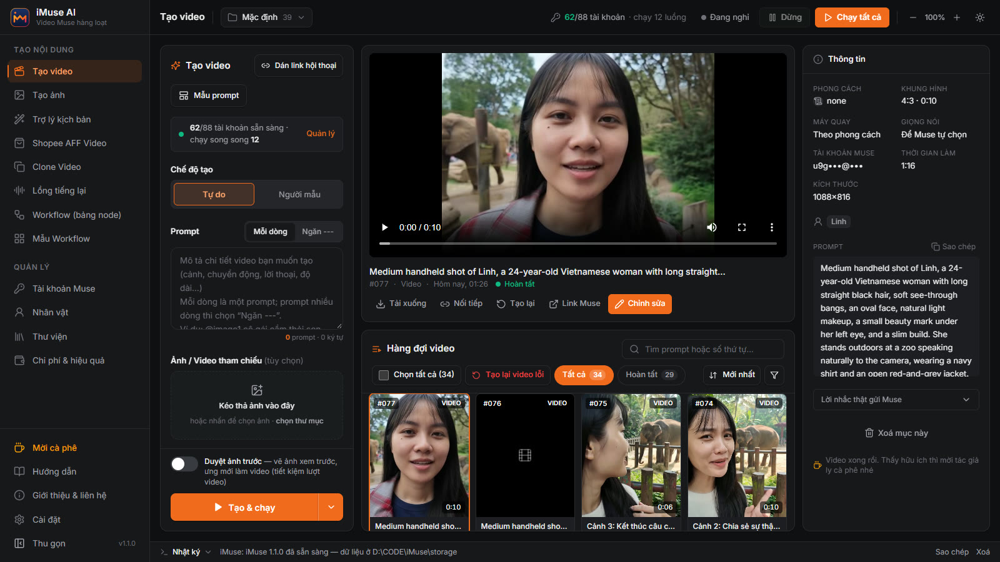
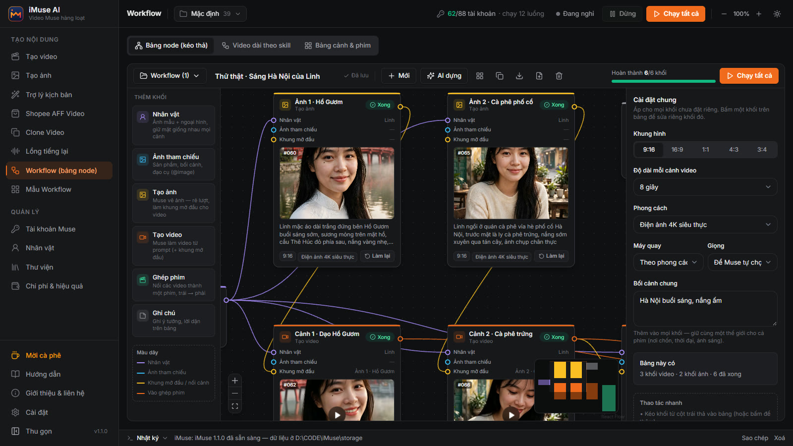
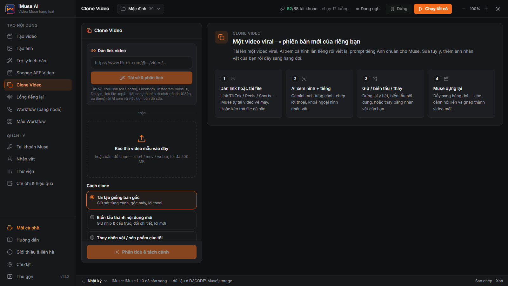
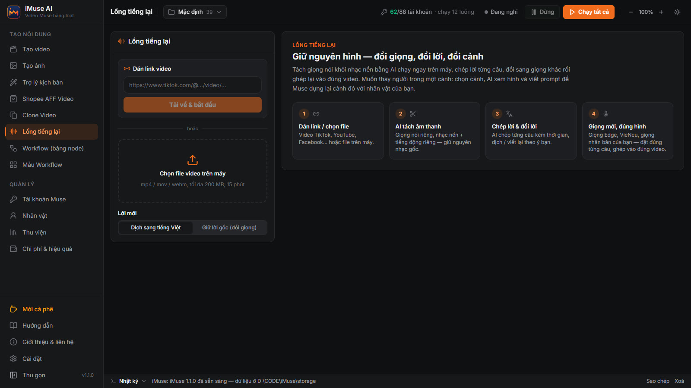

# iMuse AI

Phần mềm làm **video và ảnh hàng loạt** bằng tài khoản Muse cho **Windows** và **Mac** (chip Apple). Miễn phí, làm cho người Việt.

Dán danh sách prompt, iMuse chia việc cho nhiều tài khoản chạy song song, tự tải video về máy, giữ nguyên mặt nhân vật qua mọi cảnh và
ghép thành phim. Có thêm Workflow kéo thả, Clone video bằng link và Lồng tiếng lại.

## ⬇️ Tải về

| Máy của bạn | Tải bộ cài |
|---|---|
| 🪟 **Windows 10 / 11** (64-bit) | [**⬇️ Tải iMuse cho Windows**](https://github.com/dienmoc86/iMuse-releases/releases/latest/download/iMuse-Setup.exe) · iMuse-Setup.exe · khoảng 180 MB |
| 🍎 **Mac chip Apple** (M1 trở lên, macOS 14 Sonoma trở lên) | [**⬇️ Tải iMuse cho Mac**](https://github.com/dienmoc86/iMuse-releases/releases/latest/download/iMuse-Mac.dmg) · iMuse-Mac.dmg · khoảng 225 MB |

Mọi phiên bản và ghi chú thay đổi: mục [Releases](https://github.com/dienmoc86/iMuse-releases/releases).

**Máy cần có:** Windows 10/11 64-bit, hoặc Mac chip Apple (M1 trở lên) chạy macOS 14 Sonoma trở lên (Mac chip Intel chưa có bản);
[Google Chrome](https://www.google.com/chrome/), RAM 8 GB trở lên (mỗi tài khoản chạy cùng lúc là
một cửa sổ Chrome, tốn khoảng 0,5–1 GB RAM; máy 16 GB chạy thoải mái 4–6 tài khoản).

### Cài đặt trên Windows

1. Chạy file `iMuse-Setup.exe` → **Tiếp theo** → **Cài đặt**. Cài cho riêng tài khoản Windows đang dùng, không cần quyền quản trị.
2. Nếu Windows hiện bảng xanh *"Windows đã bảo vệ máy tính của bạn"*: bấm **Thông tin bổ sung** → **Vẫn chạy**.
3. Mở **iMuse AI** ở màn hình nền hoặc menu Start. Cửa sổ iMuse mở toàn màn hình, vài giây là vào được.
4. **Tắt hẳn:** menu Start → **Tắt iMuse**. Đóng cửa sổ thì iMuse vẫn chạy ngầm để làm nốt các video trong hàng đợi.

### Cài đặt trên Mac

1. Mở file `iMuse-Mac.dmg`, kéo biểu tượng **iMuse AI** thả vào thư mục **Applications** ngay bên cạnh, rồi đẩy ổ đĩa *iMuse AI* ra.
2. Mở **iMuse AI** trong Launchpad (hoặc Finder → Applications).
3. Lần đầu mở, macOS báo *"Apple không thể xác minh iMuse AI…"*: bấm **Xong** (đừng bấm *Chuyển vào Thùng rác*), mở
   **Cài đặt hệ thống → Quyền riêng tư & Bảo mật**, kéo xuống dưới cùng, ở dòng *"iMuse AI đã bị chặn…"* bấm **Vẫn mở** → nhập mật
   khẩu máy → **Mở**. Chỉ làm một lần, từ lần sau bấm đúp là mở.
4. **Tắt hẳn:** bấm đúp **iMuse AI** lần nữa → chọn **Tắt iMuse**. Đóng cửa sổ thì iMuse vẫn chạy ngầm để làm nốt hàng đợi.

Dữ liệu trên Mac (video, nhân vật, tài khoản, key) nằm ở `~/Library/Application Support/iMuse`.

### Kích hoạt (một lần cho mỗi máy — miễn phí)

iMuse miễn phí, key kích hoạt cũng miễn phí. Nếu có ai thu tiền bạn để cài iMuse thì đó không phải là tác giả.

1. Lần đầu mở, iMuse hiện màn hình **Kích hoạt iMuse AI** có **mã máy** (32 ký tự) của bạn. Bấm **Mở bot @Kichhoatkey_bot**:
   Telegram mở bot với mã máy điền sẵn. (Hoặc bấm **Chép** rồi tự gửi mã máy cho [@Kichhoatkey_bot](https://t.me/Kichhoatkey_bot).)
2. Trong Telegram bấm **📨 Yêu cầu kích hoạt**. Lần đầu, bot hỏi một câu xác minh ngắn — trả lời xong là bot gửi key.
3. Bot gửi **key kích hoạt** ngay trong Telegram, thường chỉ vài giây — chép key, dán vào ô *Dán key kích hoạt* trong iMuse rồi bấm
   **Kích hoạt**.

Key dùng **365 ngày**, mỗi tài khoản Telegram được cấp key ngay cho **2 máy**; máy thứ 3 trở lên hoặc gia hạn thì chờ tác giả duyệt. Xem hạn và gia hạn: *Cài đặt → Bản quyền iMuse*. Cài lại hay
cập nhật iMuse trên cùng máy **không cần** key mới. iMuse báo *"Key này dành cho máy khác"*: gửi cho bot mã máy đang hiện trên màn
Kích hoạt của **chính máy này**.

**Cập nhật:** tải bộ cài mới ở trên rồi cài đè lên bản cũ (Mac: kéo bản mới vào Applications → chọn **Thay thế**). Video, nhân vật, tài khoản và key kích hoạt được giữ nguyên.

## Bắt đầu trong 4 bước

1. **Thêm tài khoản Muse** — trang *Tài khoản Muse* → *Thêm tài khoản*: dán cookie nhiều tài khoản một lần, hoặc *Đăng nhập tay* trong
   cửa sổ Chrome riêng. Mỗi tài khoản dùng được mạng máy / VPN hoặc một proxy riêng; bấm *Kiểm tra IP* để xem tài khoản đang ra mạng
   bằng IP nước nào. Đặt số tài khoản chạy cùng lúc ở ô *Chạy song song* (tối đa 12).
2. **Thêm khoá Gemini (miễn phí)** — *Cài đặt* → *AI viết kịch bản*, lấy khoá ở [aistudio.google.com](https://aistudio.google.com/apikey).
   Khoá dùng cho Trợ lý kịch bản, Shopee AFF, Clone Video, Lồng tiếng lại và AI nhìn ảnh nhân vật. Muse không cần khoá này để làm video.
3. **Tạo nhân vật** — trang *Nhân vật* → thêm ảnh chính diện. Prompt nhắc đúng tên nhân vật (VD: *Linh mặc áo dài trắng…*) là iMuse
   gửi kèm ảnh để Muse giữ nguyên khuôn mặt, tóc, dáng người.
4. **Tạo video** — trang *Tạo video*: chọn phong cách, khung hình, mỗi dòng prompt một video → **Tạo & chạy**. Bấm một dòng trong hàng
   đợi để xem, tải xuống, tạo lại hoặc chỉnh sửa.

Trong app có trang **Hướng dẫn** đầy đủ từng mục.

## iMuse làm được gì

### Tạo video & ảnh hàng loạt, nhiều tài khoản chạy song song

- Mỗi dòng prompt một video hoặc một ảnh; hàng đợi chạy nền, tự tải kết quả về máy; lọc, tìm, tạo lại mục lỗi, tải cả lô thành `.zip`.
- Tới **12 tài khoản làm cùng lúc**. Tài khoản hết lượt, bị đăng xuất, quá giờ hay Muse trục trặc là tự chuyển sang tài khoản khác.
- **Giữ nguyên nhân vật** bằng ảnh mẫu, **20 phong cách** (điện ảnh, hoạt hình 3D, cổ trang, thú cưng…), 12 kiểu chuyển động máy quay,
  ảnh tham chiếu `@image1`, `@image2`.
- **Duyệt ảnh trước**: vẽ ảnh xem trước (lượt ảnh rẻ), ưng ảnh nào mới làm video từ ảnh đó. Video hỏng không tính lượt và tự làm lại.
- Trang **Chi phí & hiệu quả**: nhập giá mua tài khoản + proxy để biết giá mỗi video và tài khoản nào làm hiệu quả.

### Workflow bảng node — kéo thả là có phim

Kéo các khối **Nhân vật · Ảnh tham chiếu · Tạo ảnh · Tạo video · Ghép phim** lên bảng rồi nối dây: cảnh sau mở đầu bằng khung cuối cảnh
trước. Bấm **Chạy tất cả** là các khối chạy song song trên nhiều tài khoản, đủ cảnh tự ghép phim. Có mẫu dựng sẵn và nút **AI dựng** từ
một câu ý tưởng.

### Clone Video bằng link — làm bản gần giống với nhân vật khác

Dán link **TikTok, YouTube (cả Shorts), Facebook, Instagram…** hoặc chọn file trên máy. iMuse tự tải video về, AI xem cả hình lẫn tiếng,
tách từng cảnh (hình ảnh, lời thoại, chữ trên hình, âm thanh). Sau đó dựng lại y hệt, biến tấu nội dung, hoặc bấm **Làm phiên bản mới**
để đổi sang **nhân vật khác** hoặc **bối cảnh khác** mà vẫn giữ nhịp và thời lượng từng cảnh.

### Lồng tiếng lại — giữ hình, đổi giọng

AI **tách giọng nói khỏi nhạc nền** ngay trên máy, chép lời từng câu kèm thời gian, dịch sang tiếng Việt / tiếng Anh hoặc viết lại theo
ý bạn, đọc bằng **giọng khác** (giọng Edge miễn phí; giọng VieNeu và giọng nhân bản khi máy có mở iCast) rồi ghép vào đúng video, giữ
nguyên nhạc nền gốc. Muốn thay người trong một cảnh: AI xem hình viết prompt, Muse dựng lại cảnh đó với nhân vật của bạn; hoặc chèn ảnh.

### Trợ lý kịch bản & Shopee AFF Video

- Gõ ý tưởng, chọn skill → AI chia cảnh, khoá nhân vật, viết prompt (kho **2.590 prompt**, 22 skill tiếng Việt). Video dài 5–20 phút cho
  YouTube theo dàn ý.
- Dán link Shopee / TikTok Shop hoặc ảnh sản phẩm → AI viết 3 cảnh chốt đơn kèm caption bán hàng.

## Mẹo

- Mỗi prompt một hành động chính vừa với thời lượng (8 giây ≈ 2–3 nhịp). Lời thoại 18–22 từ mỗi cảnh, viết dạng `Linh says: "…"`.
- Không yêu cầu Muse viết chữ lên hình — dễ sai chính tả; thêm chữ sau bằng phần mềm dựng.
- Hàng đợi tự tạm dừng khi mọi tài khoản hết lượt; các mục vẫn giữ nguyên, thêm tài khoản rồi bấm *Chạy tiếp*.
- Lần đầu dùng **Lồng tiếng lại**, iMuse tải mô hình tách giọng khoảng 65 MB (cần mạng, chỉ tải một lần).
- Link TikTok báo bị chặn: bật VPN rồi thử lại, hoặc tải video về máy rồi chọn file.
- Thanh **Nhật ký** ở đáy ghi mọi việc iMuse đang làm — bấm *Sao chép* khi cần báo lỗi.

## Tác giả

**Mr. Điện** — góp ý, báo lỗi, muốn thêm tính năng: nhắn qua [Facebook](https://www.facebook.com/dienmoc86) ·
Kênh [YouTube](https://www.youtube.com/@aiconnhangheo)

Thấy iMuse hữu ích thì bấm **Mời cà phê** ở thanh bên trái trong app để ủng hộ tác giả.

---

Repo này chỉ chứa bộ cài và hướng dẫn, không có mã nguồn. iMuse là phần mềm độc lập, không liên kết với Muse; bạn tự chịu trách nhiệm
tuân thủ điều khoản của Muse và chỉ clone / lồng tiếng video mà bạn có quyền sử dụng. iMuse có kèm [FFmpeg](https://ffmpeg.org)
(giấy phép GPL), dùng [yt-dlp](https://github.com/yt-dlp/yt-dlp), [ONNX Runtime](https://onnxruntime.ai) và mô hình tách giọng
UVR-MDX-NET của dự án [Ultimate Vocal Remover](https://github.com/Anjok07/ultimatevocalremovergui).
